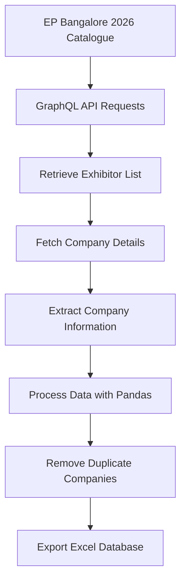

# Firm Scraper

### EP Bangalore 2026 Company Database & Job Hunting Resource

A Python-based web scraping project that collects and organizes exhibitor information from the EP Bangalore 2026 catalogue into structured Excel databases.

The project helps job seekers and software engineering professionals discover companies, research potential employers, and organize their job search using company information and a dedicated job hunting guide.

**Repository:** [ChethanNazre/Firm_Scraper](https://github.com/ChethanNazre/Firm_Scraper)

---

## Overview

Firm Scraper automates the collection of exhibitor information from the EP Bangalore 2026 online catalogue.

The scraper retrieves company information through GraphQL requests, processes the responses, extracts relevant company details, and exports the results into an Excel spreadsheet.

The repository also includes curated company databases and a job hunting guide designed to support company research and career exploration.

## Features

- Automated company information retrieval using Python
- GraphQL API integration
- Company name and company type extraction
- Industry and category classification
- Company website extraction
- Company address collection
- Excel data export using Pandas
- Duplicate company removal
- Job hunting guide for company research and application planning

## Tech Stack

| Technology | Purpose |
|---|---|
| Python | Core scripting language |
| Requests | HTTP requests to the GraphQL endpoint |
| Pandas | Data processing and Excel export |
| GraphQL | Retrieving exhibitor information |
| Excel | Structured company database storage |

## Repository Structure

```text
Firm_Scraper/
│
├── download_ep_blr_2026_companies.py
│
├── EP_BLR_2026_Company_Careers_Database.xlsx
│
├── EP_BLR_2026_Complete_Database.xlsx
│
├── JOB_HUNTING_GUIDE.md
│
└── README.md
```

### File Descriptions

| File | Description |
|---|---|
| `download_ep_blr_2026_companies.py` | Python scraper that retrieves exhibitor details and exports them to Excel |
| `EP_BLR_2026_Company_Careers_Database.xlsx` | Company database containing careers and company research information |
| `EP_BLR_2026_Complete_Database.xlsx` | Complete company database for research and analysis |
| `JOB_HUNTING_GUIDE.md` | Guide for prioritizing companies and organizing job applications |

## Getting Started

### Prerequisites

Ensure that the following are installed:

- Python 3.8 or later
- pip
- Git
- Microsoft Excel or a compatible spreadsheet application

### 1. Clone the Repository

```bash
git clone https://github.com/ChethanNazre/Firm_Scraper.git
```

### 2. Navigate to the Project Directory

```bash
cd Firm_Scraper
```

### 3. Create a Virtual Environment

```bash
python -m venv venv
```

Activate the virtual environment in Windows PowerShell:

```powershell
.\venv\Scripts\Activate.ps1
```

### 4. Install Dependencies

```bash
pip install requests pandas openpyxl
```

### 5. Run the Scraper

```bash
python download_ep_blr_2026_companies.py
```

The script retrieves exhibitor information and generates:

```text
EP_BLR_2026_Company_Careers_Database.xlsx
```

The generated Excel file contains structured company information that can be used for research and job hunting.

## Data Fields

The scraper extracts the following information:

| Field | Description |
|---|---|
| Company Name | Name of the exhibitor |
| Company Type | Exhibitor classification |
| Industry / Category | Company industry or category |
| Main Category | Primary industry classification |
| Sub Category | Secondary industry classification |
| Website | Company website |
| Address | Company address and location |

## How It Works



The scraper performs the following operations:

1. Connects to the exhibitor catalogue's GraphQL endpoint.
2. Retrieves the exhibitor list for the EP Bangalore 2026 group.
3. Fetches detailed information for each company.
4. Extracts company names, categories, websites, and addresses.
5. Processes the collected records using Pandas.
6. Removes duplicate companies based on company name.
7. Exports the processed information to an Excel spreadsheet.

## Job Hunting Guide

The repository includes `JOB_HUNTING_GUIDE.md`, which provides guidance on using the company database for job hunting.

The guide covers:

- Company research and prioritization
- Relevance score-based company selection
- Identifying potential software engineering employers
- Researching company technology stacks
- Tracking job applications
- Preparing for company outreach and interviews

The database can be used to organize company research and maintain an application pipeline.

## Important Notes

- The scraper depends on the availability and structure of the exhibitor catalogue's GraphQL API.
- The event catalogue may change its API structure or access requirements.
- The scraper includes a small delay between requests to reduce request frequency.
- Company information should be verified through official company websites before applying for jobs.
- Use the scraper responsibly and respect the data source's terms of service.

## Future Improvements

Potential enhancements include:

- Exporting data to CSV and JSON
- Adding command-line options for filtering companies
- Implementing retry logic for failed requests
- Adding structured logging
- Supporting incremental data updates
- Building a searchable company dashboard
- Integrating company career page discovery

## Author

**Chethan Nazre S**

GitHub: [@ChethanNazre](https://github.com/ChethanNazre)

## License

This repository is distributed under the [Unlicense](https://unlicense.org/), as indicated by the repository's license configuration.
